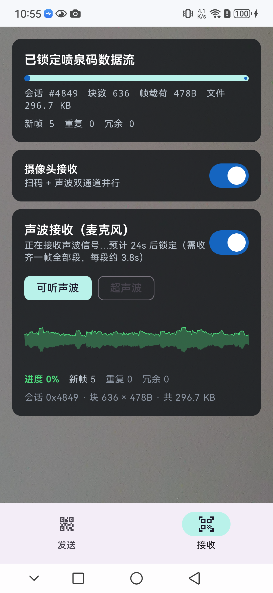
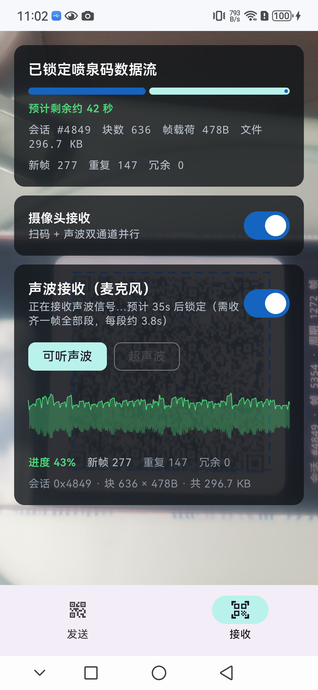
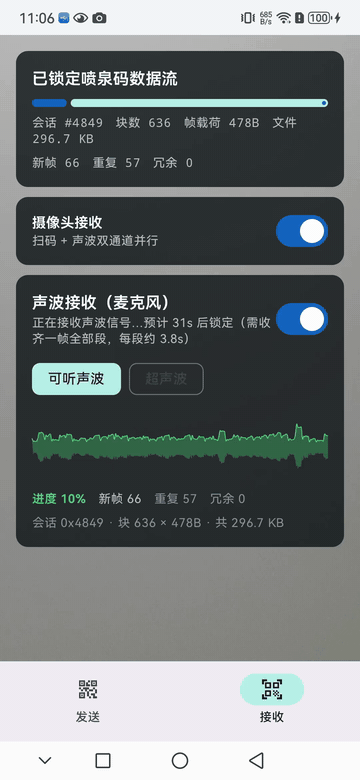
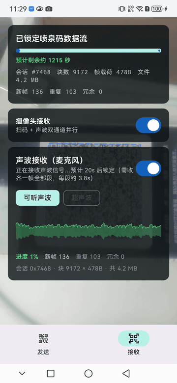

# AirFountainZulu

[中文](#zh) | [English](#en)

<a id="zh"></a>

## 中文

基于**喷泉码（Fountain Code / LT Code）**的跨网文件传输工具——不依赖 Wi-Fi、蓝牙、USB、网络，仅用**屏幕发光 + 摄像头拍摄**即可完成文件传输；还可开启**声波通道**（扬声器 + 麦克风）双通道并行互补。

发送端屏幕高速播放二维码流，接收端摄像头对准屏幕即可自动锁定、重组、校验并还原文件。丢帧、乱序、中途加入均无感。开启声波后，同一喷泉码帧同时经二维码与声波两条信道发送，任一信道丢帧由另一条补齐。

### 核心特性

- **喷泉码传输**：LT 码无速率编码，任意帧序、任意丢帧、随时加入/离开
- **自描述帧**：每帧携带完整 22 字节头部，无需握手协议，中途锁定流
- **DCF2 容器**：自动保留文件名/MIME 类型，可选 gzip 压缩，SHA-256 完整性校验
- **声波通道**：纯 Kotlin 全量移植 [ggwave](https://github.com/ggerganov/ggwave)，大帧拆 64B 声波段传输、接收端重组还原原始帧，与二维码通道共用同一 LT 解码器
- **声波可视化与省电开关**：收发两端实时贝塞尔频谱包络曲线（Catmull-Rom 平滑），接收页附进度详情（进度/新帧/重复/冗余/会话/块数）与剩余时间预计；接收端可关闭摄像头改纯声波接收省电，卡片 80% 半透明便于观察二维码
- **二维码锁定框仿射跟随**：检出二维码后叠加蓝色虚线四角框（ZXing 定位点 + 第 4 角平行四边形推算），实时跟随旋转与透视畸变；信息层可滚动，完成卡不溢出
- **三级集成解码链**：Hybrid/全局直方图快路径 → 半分辨率定位裁剪（排除眩光带/阴影带）→ Sauvola 局部自适应阈值兜底，对屏幕拍摄的低对比度、眩光、摩尔纹远比单一二值化鲁棒
- **中英双语界面**：全部界面文案走 Android 字符串资源（`values/` 英文、`values-zh/` 中文），启动时按手机时区自动切换——UTC+7、+8、+9、+10 使用中文，其余时区使用英文
- **R8 代码压缩**：release 构建开启 R8 代码裁剪/混淆与资源压缩，APK 约 1.7 MB；保留源码行号信息，便于线上崩溃定位
- **跨平台**：Android（Jetpack Compose）+ Windows 桌面（Compose Multiplatform）+ Web（Kotlin/Wasm + Compose Multiplatform Web），三端逐位兼容，声波协议亦可跨端互通
- **单文件 Web 版**：Kotlin/Wasm 编译产物内联为单个 HTML（约 6 MB），双击即用、完全离线、无服务器依赖；二维码编码走纯 Kotlin QrMatrix，扫码走浏览器 BarcodeDetector

### 界面截图

<table>
  <tr>
    <td width="50%" align="center">
      <br/>
      <sub><b>接收页</b>：已锁定数据流，声波锁定倒计时、档位切换、贝塞尔频谱包络与进度详情（80% 半透明卡片）</sub>
    </td>
    <td width="50%" align="center">
      <br/>
      <sub><b>锁定框</b>：检出二维码后叠加蓝色虚线四角框，仿射贴合旋转/透视；完成卡含自动保存路径与 SHA-256</sub>
    </td>
  </tr>
  <tr>
    <td width="50%" align="center">
      <br/>
      <sub><b>6 秒动态演示</b>：进度条 / 贝塞尔波形 / 传输剩余与声波锁定双倒计时实时变化</sub>
    </td>
    <td width="50%" align="center">
      <br/>
      <sub><b>4.2MB 接收实况</b>：9172 块 × 478B，新帧/重复计数持续累积，双倒计时并行刷新</sub>
    </td>
  </tr>
</table>

### 项目结构

```
AirFountainZulu/
├── app/                        # Android 应用（Kotlin + Jetpack Compose）
│   ├── proguard-rules.pro      # R8 自定义规则（保留行号，无额外 keep）
│   └── src/main/java/com/airscan/qr/
│       ├── AppLocale.kt        # 按手机时区选择 zh/en 并包装 Context
│       ├── core/               # 喷泉码核心（纯 Kotlin，两端复用）
│       │   ├── Prng.kt         # SplitMix32 确定性随机数
│       │   ├── Fountain.kt     # LT 编解码器（编码/剥层解码）
│       │   ├── Wire.kt         # 自描述帧协议（22B 小端头部）
│       │   ├── Container.kt    # DCF2 文件容器（49B 头 + 可选 gzip + SHA-256）
│       │   ├── ggwave/         # ggwave 纯 Kotlin 全量移植
│       │   │   ├── Gf.kt           # GF(2^8) 有限域
│       │   │   ├── ReedSolomon.kt  # RS 前向纠错（Berlekamp-Massey + Forney）
│       │   │   ├── Rdft.kt         # Ooura 实数 FFT
│       │   │   ├── Resampler.kt    # sinc 插值重采样
│       │   │   └── GGWave.kt       # 调制/解调引擎（12 协议 + DSS）
│       │   └── audio/
│       │       └── AudioSegment.kt # 喷泉码帧 ↔ 64B 声波段 分段/重组协议
│       ├── qr/                 # ZXing 二维码生成（字节模式 ISO-8859-1，ECC-L）
│       ├── camera/             # CameraX 取景 + ZXing 条码识别（三级解码链 + Sauvola 自适应阈值）
│       ├── audio/              # AudioTrack 扬声器发送 + AudioRecord 麦克风接收
│       ├── ui/                 # Compose 发送/接收界面（含声波开关）
│       └── MainActivity.kt
├── app/src/main/res/
│   ├── values/strings.xml      # 英文（默认语言）
│   └── values-zh/strings.xml   # 中文
├── desktop/                    # Windows 桌面应用（Compose Multiplatform）
│   └── src/desktopMain/kotlin/com/airscan/zulu/
│       ├── Main.kt             # 4:3 窗口（1024×768）
│       ├── SenderTab.kt        # 发送端（文件选择 + 喷泉码播放 + 声波开关）
│       ├── ReceiverTab.kt      # 接收端（webcam + 声波接收，双通道重组）
│       ├── DesktopAudio.kt     # javax.sound.sampled 声波收发（与 Android 同协议）
│       └── QrBitmap.kt         # 二维码渲染（与 Android 端参数一致）
├── web/                        # Web 端（Kotlin/Wasm + Compose Multiplatform Web）
│   └── src/wasmJsMain/kotlin/com/airscan/zulu/
│       ├── Main.kt             # CanvasBasedWindow 入口，复用 app 核心
│       ├── SenderTab.kt        # 发送端（文件选择 + 纯 Kotlin QrMatrix 二维码）
│       ├── ReceiverTab.kt      # 接收端（BarcodeDetector 扫码 + 喷泉码重组 + Blob 下载）
│       ├── JsBridge.kt         # 浏览器桥（文件/下载/摄像头，顶层 @JsFun external）
│       ├── QrView.kt           # 二维码 Canvas 矢量绘制 + 纯 Kotlin Base64
│       └── com/airscan/qr/core/ # 直接复用 app/src/main/java/.../core（排除 JVM/声波）
├── web/tools/singlefile.py     # 内联脚本/wasm 生成单文件 HTML（fetch+XHR 拦截，file:// 可用）
├── launcher/
│   └── Launcher.cs             # .NET 4 单文件启动器源码
├── app/src/test/               # 单元测试（72 项：喷泉码/容器 + RS/FFT/ggwave 往返/段重组 + QR 编解码/Sauvola）
├── build-with-timestamp.sh     # 一键构建脚本（robocopy 到全英文路径再构建）
└── airscan-release.keystore    # 签名密钥库
```

### 技术栈

| 组件 | 技术 |
|------|------|
| Android | Kotlin 2.0 + Jetpack Compose (BOM 2024.10.01) |
| 桌面端 | Compose Multiplatform 1.7.0 (JVM) |
| Web 端 | Kotlin/Wasm + Compose Multiplatform 1.7.0 (Web) |
| 喷泉码 | 自研 LT 编解码（与 decimen v3 线格式兼容） |
| 声波调制 | ggwave 纯 Kotlin 移植（16 进制音调 FSK + RS 纠错，MIT） |
| Android 声波 | AudioTrack（MODE_STREAM 发送）+ AudioRecord（VOICE_RECOGNITION 源接收，无 AGC/降噪）48kHz 单声道 PCM16 |
| 桌面声波 | javax.sound.sampled（SourceDataLine / TargetDataLine），与 Android 线格式一致 |
| 二维码生成 | ZXing core 3.5.3（字节模式，ISO-8859-1，纠错级 L） |
| Web 二维码生成 | 纯 Kotlin QrMatrix（v1–40，纠错级 L，GF(2^8) RS 复用 ggwave），wasm 端无 zxing/AWT |
| Android 扫码 | ZXing QRCodeReader（ISO-8859-1 强制映射；三级解码链：Hybrid/GH → 半分辨率定位裁剪 → Sauvola 局部自适应阈值） |
| 桌面端扫码 | ZXing QRCodeReader（CHARACTER_SET=ISO-8859-1 强制映射） |
| Web 扫码 | 浏览器 BarcodeDetector API（Chrome/Edge，rawValue 逐字节映射） |
| Web 单文件 | singlefile.py 内联 composeApp.js + 两个 wasm（gzip+base64），fetch+XHR 拦截兼容 file:// |
| 桌面摄像头 | webcam-capture 0.3.12 |
| 启动器 | .NET Framework 4.x（单文件 WinExe，内嵌 zip 自解压） |
| 国际化 | Android 资源 `values/`（英文）+ `values-zh/`（中文），`AppLocale` 按手机时区选择 Locale |
| 代码压缩 | R8（`minifyEnabled true` + `shrinkResources true` + `proguard-android-optimize.txt`） |

### 多语言策略

- 默认语言为英文（`app/src/main/res/values/strings.xml`），中文位于 `app/src/main/res/values-zh/strings.xml`
- 启动时读取手机时区原始偏移（`TimeZone.rawOffset`，忽略夏令时）：
  - **UTC+7、+8、+9、+10** → 中文
  - **其他时区** → 英文
- `MainActivity.attachBaseContext` 与 ViewModel 均使用 `AppLocale.localized(context)`，保证 Compose 界面与运行时提示（错误、进度、完成卡）使用同一语言
- 修改系统时区后，需重启应用或重建 Activity 生效
- 桌面端与 Web 端仍为中文界面，不在本次多语言范围内

### 传输协议

#### 帧格式（22 字节小端头部 + 载荷）

```
 0  u8   magic 0xD1
 1  u8   magic 0xC3
 2  u8   version = 3
 3  u8   flags
 4  u16  sessionId     每次发送随机生成
 6  u32  seq           帧序号（PRNG 种子输入）
10  u16  k             源块数
12  u16  blockLen      每帧载荷字节数
14  u32  totalLen      DCF2 容器总长度
18  u32  payloadFnv    容器 FNV-1a 哈希（完成后校验）
22  ...  blockLen 字节喷泉码编码块
```

#### DCF2 容器（49 字节小端头部 + 元数据 + 数据）

```
 0  4B   magic "DCF2"
 4  u8   compression  0=none 1=gzip
 5  u16  nameLength
 7  u16  typeLength
 9  u32  fileLength        原始文件长度
13  u32  transmittedLength 实际承载长度
17  32B  sha256(原始文件)
49  ...  name UTF-8 + type UTF-8 + transmitted bytes
```

### 通信原理

#### 分层模型：信道 → 调制 → 编码

| 层次 | 光信道（屏幕 → 摄像头） | 声波信道（扬声器 → 麦克风） |
|------|------|------|
| 物理信道 | 可见光亮度场（屏幕逐帧刷新） | 空气声波：可听档约 1.9–10.8 kHz，超声档 15–23.9 kHz |
| 调制方式 | 二维码（二维空间并行编码） | 多频 FSK（每符号 16 选 1 音调，6 音并行） |
| 帧内纠错 | QR Reed-Solomon（纠错级 L） | RS(64, 24)，每段可纠 12 字节 |
| 帧封装 | 22B 头 + 块（一个二维码 = 一帧） | 64B 声波段（14B 段头 + 50B 载荷），≤32 段拼回一帧 |
| 帧级编码 | LT 喷泉码（两信道共用） | LT 喷泉码（两信道共用） |

**分工哲学**：帧内纠错（QR RS / 声波 RS）保证"收到的帧必然无误码"；喷泉码保证"任意凑够 k 帧即可还原"。信道只需多数帧送达、允许整帧丢失——这也是双通道并行互补的基础：二维码与声波各自收到的帧都进同一个 `LTDecoder`，一边被遮挡/受干扰时另一边自动补帧。

#### 光信道：二维码调制 / 解调

- **调制**：喷泉码帧（22B 头 + 块）→ ZXing 生成二维码（字节模式，ISO-8859-1 保证字节与码字 1:1 映射）→ 屏幕以 10–30 fps 逐帧刷新
- **解调**：CameraX 逐帧取景 → ZXing 三级集成解码（全帧 Hybrid/GH 快路径 → 半分辨率 `Detector` 定位后角点外扩 25% 裁剪全分辨率、排除眩光/阴影带 → 全帧 Sauvola 局部自适应阈值兜底）逐字节还原 payload → `classifyFrame` 校验 magic/版本 → `LTDecoder.addFrame`
- 二维码自带 Finder 图案定位与 RS 纠错；整帧解码失败即视为丢帧，由喷泉码吸收

#### 声波信道：ggwave 多频 FSK 调制 / 解调

**分段**：喷泉码帧（522–1487B）远超 ggwave 单次传输容量，故拆成 64B 声波段：

```
 0  u8   magic 'A' (0x41)
 1  u8   magic 'S' (0x53)
 2  u8   version = 1
 3  u8   flags       低 5 位 = 段总数-1（1..32）
 4  u16  sessionId   与喷泉码帧头一致
 6  u32  seq         喷泉码帧序号
10  u16  frameLen    原始帧总长
12  u8   segIndex
13  u8   reserved
14  50B  原始帧切片（末段不足补 0）
```

**调制（Tx）**：

1. 64B 段 → RS(64, 24) 加纠错得 88B 码字
2. 码字按 3B/块分组（88B → 30 块）；每字节拆高低 4bit 得 6 个十六进制符号
3. 第 j 槽位符号 d 发送频率 `f = 46.875·freqStart + 93.75·(16j + d)` Hz（48 kHz / 1024 点 FFT，bin 间隔 46.875 Hz；槽位间间隔 93.75 Hz，符号间无混叠）
4. 6 路单音叠加合成 1024 样本一帧（21.3 ms），各音调相位按位序错开 πk/24 降低峰均比；同一块重复 6 帧（Fast 档），波形边缘 15% 余弦淡入淡出防爆音
5. 档位：可听 `freqStart=40`（1875 Hz 起）、超声 `freqStart=320`（15 kHz 起）；固定帧长模式无起止标记音开销

**解调（Rx）**：

1. 麦克风流按 1024 样本滑窗 → Ooura 实数 FFT → 功率谱（4 帧历史叠加）
2. 每槽位在其 16 个候选 bin 上取 argmax 还原符号，跨 6 帧多数投票（>3 帧一致才采纳）→ 3B/块 → 30 块拼齐 88B
3. RS 解码纠错 → 校验通过得 64B 段 → 段头字段校验 → `Reassembler` 拼齐同一帧的全部段 → 还原原始喷泉码帧 → 复用二维码的 `onFrame` 入口
4. 接收端只启用目标协议（可听或超声单档）参与检测，显著降低误检率

**吞吐定位**：单段 64B 约 3.8 s（净载荷约 13 B/s），仅作兜底通道——主力吞吐由二维码承担，声波负责暗光、角度受限、摄像头无法对准屏幕时补帧；两台设备无需屏幕互相可见，隔墙也可经声波传完。

### 构建

#### 前置条件

- JDK 17（已内置在 `tools/jdk-17.0.2/`）
- Gradle 8.13（已内置在 `tools/gradle-8.13/`）
- Android SDK 34（通过 `local.properties` 指向）
- Git Bash（运行构建脚本）

#### 一键构建（推荐）

```bash
./build-with-timestamp.sh
```

流程：robocopy 镜像到全英文暂存目录 `D:\afz_build` → 单元测试 → 签名 release APK → 桌面分发版 → APK 回拷项目根目录（带时间戳后缀）。

#### 手动构建

```bash
export JAVA_HOME="$PWD/tools/jdk-17.0.2"
export PATH="$JAVA_HOME/bin:$PATH"

# Android APK（签名 release，已开启 R8）
./tools/gradle-8.13/bin/gradle.bat :app:assembleRelease --no-daemon

# 桌面分发版（免安装目录）
mkdir -p build/wix311   # 绕过 WiX 校验（打 MSI 才需要真正的 WiX）
./tools/gradle-8.13/bin/gradle.bat :desktop:createDistributable -x downloadWix -x unzipWix --no-daemon

# 单元测试
./tools/gradle-8.13/bin/gradle.bat :app:testDebugUnitTest --no-daemon

# Web 单文件版（Kotlin/Wasm，需联网下载 Compose wasm 依赖）
./tools/gradle-8.13/bin/gradle.bat :web:wasmJsBrowserDistribution --no-daemon
# 内联为单文件 HTML（输出到项目根目录 AirFountainZulu-web.html）
python3 web/tools/singlefile.py web/build/dist/wasmJs/productionExecutable
```

> **注意**：项目路径含中文时 Gradle 测试进程的类路径会乱码导致 `ClassNotFoundException`，构建脚本通过 robocopy 到 `D:\afz_build` 规避此问题。Web 构建同样建议在全英文路径下进行；Compose 运行时会写入 `~/.skiko`，需保证该目录可写。

#### R8 代码压缩

Android release 构建已启用 R8 代码裁剪/混淆与资源压缩：

```gradle
buildTypes {
    release {
        minifyEnabled true
        shrinkResources true
        proguardFiles getDefaultProguardFile('proguard-android-optimize.txt'), 'proguard-rules.pro'
        signingConfig signingConfigs.release
    }
}
```

- 基线规则：`proguard-android-optimize.txt`；AndroidX / Compose / CameraX 自带 consumer 规则
- 自定义规则：`app/proguard-rules.pro`——当前代码无反射、无 JNI，无需额外 keep；保留 `SourceFile` 与 `LineNumberTable` 便于崩溃栈还原
- 混淆映射：`app/build/outputs/mapping/release/mapping.txt`，发布时建议与 APK 一同归档
- 体积：release APK 约 **1.7 MB**
- F-Droid 构建使用同一 Gradle 配置，可直接复现

#### 打包单文件启动器

```powershell
# 1. 压缩桌面分发版
Compress-Archive -Path "D:\afz_build\desktop\build\compose\binaries\main\app\AirFountainZulu\*" `
    -DestinationPath "$env:TEMP\afz_payload.zip" -CompressionLevel Optimal

# 2. 用 .NET 4 csc 编译（zip 嵌入为资源）
& "C:\Windows\Microsoft.NET\Framework64\v4.0.30319\csc.exe" /nologo /target:winexe `
    /platform:anycpu /optimize+ `
    /out:AirFountainZulu-launcher.exe `
    /resource:"$env:TEMP\afz_payload.zip,payload.zip" `
    /r:System.dll /r:System.Core.dll /r:System.IO.Compression.dll `
    /r:System.IO.Compression.FileSystem.dll /r:System.Windows.Forms.dll `
    launcher\Launcher.cs
```

### 权限

F-Droid 审核相关：应用仅申请两项运行时权限，且均按需申请。

| 权限 | 用途 | 说明 |
|------|------|------|
| `android.permission.CAMERA` | 扫描发送端屏幕上的二维码 | 关闭摄像头开关后可不使用；`uses-feature` 标记为非必需 |
| `android.permission.RECORD_AUDIO` | 声波接收（麦克风） | 仅开启声波接收时需要；`uses-feature` 标记为非必需 |

- **无网络权限**（无 `INTERNET`），不发起任何网络请求
- **无存储权限**：接收完成后通过 MediaStore/SAF 写入 `Download/AirFountainZulu/`
- 无后台服务、无自启动、无广告/统计 SDK
- 摄像头与麦克风硬件均标记为 `required="false"`，无摄像头设备仍可安装并使用纯声波模式

### 使用

#### Android ↔ Android

1. 发送端打开 App → 选择文件 → 点击「开始发送」
2. 接收端打开 App → 切到「接收」→ 摄像头对准发送端屏幕——**保持 25–35cm 距离**（太近会超出镜头最近对焦距离而失焦）——检出二维码后画面上会叠加**蓝色虚线锁定框**（按四角点仿射贴合，随二维码旋转/透视变形），移开即消失
3. 进度条走满后文件**自动保存**到系统 `Download/AirFountainZulu/`（目录自动新建，无需存储权限），也可用「另存为…」选择其他位置；卡片较多时信息层可上下滚动，完成卡完整可见

**界面语言**：应用启动时按手机时区自动选择中文或英文（UTC+7/+8/+9/+10 中文，其余英文），无需手动设置；切换系统时区后重启应用生效。

**开启声波双通道**：发送端在参数卡打开「声波发送（扬声器）」开关；接收端打开「声波接收（麦克风）」开关（首次弹出麦克风权限）。开启后二维码与声波同时收发，状态卡会显示声波信号检测情况。两档位均可选：可听声波（人耳可闻）或超声波（约 15 kHz，安静环境近距离使用）。

**声波可视化与省电**：声波开启后，收发两端均实时显示贝塞尔频谱包络曲线（信号活动绿色）；接收端声波卡附进度详情（进度/新帧/重复/冗余、会话与块数）。接收页可单独关闭「摄像头接收」开关改为纯声波接收——适合暗光、摄像头无法对准屏幕或长时间待机省电的场景；此时隔墙也可由声波独立完成传输（吞吐约 13 B/s，大文件耗时较长）。

**剩余时间预计**：接收页实时显示两类倒计时——①「预计剩余约 X 秒」显示在进度条下方，按最近 6 秒窗口的实际唯一帧到达速率外推，随二维码/声波任一通道的实际吞吐自动校准；②声波锁定预计（如「预计 28s 后锁定」）——声波需收齐一帧的全部段（每段约 3.8 s）才能建立喷泉码流，锁定前按剩余段数 × 单段耗时倒计时，这是协议机制而非卡死。接收界面卡片为 80% 半透明，方便透过卡片观察镜头对准屏幕的情况。

#### Windows 桌面版

1. 双击 `AirFountainZulu-26.10.8.18-launcher.exe`（首次运行自动释出到 `%LOCALAPPDATA%\AirFountainZulu\`）
2. 发送：选择文件 → 开始发送；接收：开始接收 → 摄像头对准屏幕
3. 接收完成后自动保存到 `~/Downloads/AirFountainZulu/`（目录自动新建），仍可手动另存

桌面端同样提供「声波发送/接收」开关（可听/超声两档），与 Android 端协议一致，可跨端互通。

#### Web 单文件版

1. 双击 `AirFountainZulu-web.html`（无需服务器、无需联网、无安装）；或用 Chrome/Edge 打开本地文件
2. **发送**：切到「发送」→ 点击「选择文件…」→ 选择帧大小（500B/1000B/1465B）→ 点击「开始发送」，屏幕播放二维码流
3. **接收**：切到「接收」→ 打开摄像头开关（需 Chrome/Edge，调用 `BarcodeDetector`）→ 对准发送端屏幕，摄像头画面显示在页面右下角小窗；收齐后点击「保存到下载目录」
4. 接收完成卡显示文件名、大小、MIME 与 SHA-256，校验通过后才能下载

> **限制**：Web 版仅支持二维码光信道，**不支持声波通道**（浏览器无低延迟音频 IO）；接收依赖 `BarcodeDetector`（Chrome/Edge 94+，Firefox 不支持）；HTTP 协议非加密时摄像头需 `localhost` 或 `https://`。

#### 参数说明

| 参数 | 选项 | 说明 |
|------|------|------|
| 帧大小 | 500B / 1000B / 1465B | 每帧二维码载荷字节数，越大吞吐越高但识别率下降 |
| 帧率 | 10 / 15 / 24 / 30 fps | 播放速度，高帧率需要更好的摄像头 |
| 声波档位 | 可听声波 / 超声波 | 可听档穿透性好；超声档人耳不可闻但易被阻挡、依赖扬声器高频响应 |

### 限制

- 单文件上限 **64 MB**（`Container.MAX_FILE_BYTES`）
- 最大帧载荷 1465B（二维码字节模式 ECC-L 容量约 2953B，留有余量）
- 声波通道仅支持 ≤1600B（含 22B 头）的帧，且吞吐仅约 13 B/s，定位为兜底通道
- Android 扫码建议保持 25–35cm 距离：更近会超出手机镜头最近对焦距离完全失焦，更远则 500B 大帧的每模块像素数会跌破 ZXing 解码极限
- 超声档依赖扬声器/麦克风高频响应，多数笔记本麦克风 16 kHz 以上衰减严重，建议优先可听档
- Windows 桌面版打包 MSI 安装包需要 WiX 工具链（本机网络受限时跳过，免安装版不受影响）
- Android 需授权摄像头权限（扫码）与麦克风权限（声波接收）；桌面版需摄像头硬件
- Web 版无声波通道；接收依赖 Chrome/Edge 的 `BarcodeDetector`，摄像头需 `https://` 或 `localhost`；Wasm 首次编译约需数十秒

### 参考项目

- [decimen](https://github.com/spite-triangle/decimen) — 喷泉码线格式与 DCF2 容器协议来源
- [ggwave](https://github.com/ggerganov/ggwave) — 声波数据调制/解调库（MIT），本项目纯 Kotlin 全量移植并保持线格式兼容
- [AirScan-QR](https://github.com/HMBSbige/AirScan-QR) — 普通 QR 顺序分片参考
- [airgapped-qr-code-transfer](https://github.com/Ruk33/airgapped-qr-code-transfer) — 气隙传输参考
- [AI-QR-Code-Decoder](https://github.com/Brainydaps/AI-QR-Code-Decoder) — 多假设冗余解码思想来源（本项目将其轻量化为多二值化 × 多尺度集成链）

---

<a id="en"></a>

## English

A cross-network file transfer tool built on **fountain codes (LT codes)**. It works without Wi-Fi, Bluetooth, USB, or any network connection: the sender's screen displays a stream of QR codes and the receiver's camera captures them. An optional **audio channel** (speaker + microphone) runs in parallel and complements the optical channel.

The receiver locks onto the stream, reassembles the file, and verifies its integrity. Dropped, reordered, or late frames do not matter. When audio is enabled, every fountain-code frame is transmitted over both QR and audio channels, and losses on one channel are covered by the other.

### Features

- **Fountain-code transfer**: rateless LT codes; any frame order, any frame loss, join or leave at any time
- **Self-describing frames**: each frame carries a complete 22-byte header; no handshake and no need to catch the start of the stream
- **DCF2 container**: preserves file name/MIME type, optional gzip compression, SHA-256 integrity verification
- **Audio channel**: full pure-Kotlin port of [ggwave](https://github.com/ggerganov/ggwave); large frames are split into 64-byte audio segments, reassembled by the receiver, and share the same LT decoder as the QR channel
- **Audio visualization and power saving**: real-time Bezier spectrum envelopes (Catmull-Rom smoothed) on both ends; the receiver shows progress details (progress/new/duplicate/redundant/session/blocks) and an ETA. The camera can be switched off for audio-only receiving, and cards are 80% opaque so the QR code remains visible behind them
- **Affine-following QR lock overlay**: after detection, a blue dashed quad tracks the QR code's rotation and perspective distortion (ZXing finder points plus a parallelogram-derived fourth corner). The info layer scrolls so the completion card is never clipped
- **Three-stage integrated decode chain**: Hybrid/global-histogram fast path → half-resolution detection and corner-cropped region (excluding glare/shadow bands) → full-frame Sauvola local adaptive threshold fallback. Far more robust than a single binarizer for low-contrast screen captures, glare, and moiré
- **Bilingual UI**: all UI strings live in Android resources (`values/` English, `values-zh/` Chinese). The language is selected automatically from the device time zone: UTC+7, +8, +9, +10 use Chinese; all other zones use English
- **R8 code shrinking**: release builds enable R8 code shrinking/obfuscation and resource shrinking. The APK is about 1.7 MB, and source line numbers are kept for crash triage
- **Cross-platform**: Android (Jetpack Compose) + Windows desktop (Compose Multiplatform) + Web (Kotlin/Wasm + Compose Multiplatform Web), bit-compatible across all three; the audio protocol also interoperates
- **Single-file Web build**: the Kotlin/Wasm output is inlined into one HTML file (about 6 MB). Double-click to run, fully offline, no server. QR encoding uses pure-Kotlin QrMatrix; scanning uses the browser BarcodeDetector API

### Screenshots

<table>
  <tr>
    <td width="50%" align="center">
      <br/>
      <sub><b>Receiver</b>: stream locked, audio lock countdown, profile switch, Bezier spectrum envelope and progress details (80% opaque cards)</sub>
    </td>
    <td width="50%" align="center">
      <br/>
      <sub><b>Lock overlay</b>: blue dashed quad follows rotation/perspective; completion card shows the auto-save path and SHA-256</sub>
    </td>
  </tr>
  <tr>
    <td width="50%" align="center">
      <br/>
      <sub><b>6-second demo</b>: progress bar, Bezier waveform, transfer ETA and audio lock countdown updating in real time</sub>
    </td>
    <td width="50%" align="center">
      <br/>
      <sub><b>4.2 MB live receive</b>: 9172 blocks × 478 B, new/duplicate counters accumulating, both countdowns refreshing</sub>
    </td>
  </tr>
</table>

### Project structure

```
AirFountainZulu/
├── app/                        # Android app (Kotlin + Jetpack Compose)
│   ├── proguard-rules.pro      # Custom R8 rules (keep line numbers, no extra keeps)
│   └── src/main/java/com/airscan/qr/
│       ├── AppLocale.kt        # Picks zh/en from the device time zone and wraps Context
│       ├── core/               # Fountain-code core (pure Kotlin, shared)
│       │   ├── Prng.kt         # SplitMix32 deterministic PRNG
│       │   ├── Fountain.kt     # LT encoder/decoder (encode/peeling decode)
│       │   ├── Wire.kt         # Self-describing frame protocol (22B little-endian header)
│       │   ├── Container.kt    # DCF2 file container (49B header + optional gzip + SHA-256)
│       │   ├── ggwave/         # Full pure-Kotlin port of ggwave
│       │   │   ├── Gf.kt           # GF(2^8) finite field
│       │   │   ├── ReedSolomon.kt  # RS FEC (Berlekamp-Massey + Forney)
│       │   │   ├── Rdft.kt         # Ooura real FFT
│       │   │   ├── Resampler.kt    # sinc resampling
│       │   │   └── GGWave.kt       # Modulation/demodulation engine (12 protocols + DSS)
│       │   └── audio/
│       │       └── AudioSegment.kt # Frame ↔ 64B audio segment split/reassembly protocol
│       ├── qr/                 # ZXing QR generation (byte mode ISO-8859-1, ECC-L)
│       ├── camera/             # CameraX preview + ZXing scanning (3-stage decode chain + Sauvola)
│       ├── audio/              # AudioTrack sender + AudioRecord receiver
│       ├── ui/                 # Compose send/receive UI (audio switches included)
│       └── MainActivity.kt
├── app/src/main/res/
│   ├── values/strings.xml      # English (default)
│   └── values-zh/strings.xml   # Chinese
├── desktop/                    # Windows desktop app (Compose Multiplatform)
│   └── src/desktopMain/kotlin/com/airscan/zulu/
│       ├── Main.kt             # 4:3 window (1024×768)
│       ├── SenderTab.kt        # Sender (file picker + fountain playback + audio switch)
│       ├── ReceiverTab.kt      # Receiver (webcam + audio, dual-channel reassembly)
│       ├── DesktopAudio.kt     # javax.sound.sampled audio I/O (same protocol as Android)
│       └── QrBitmap.kt         # QR rendering (same parameters as Android)
├── web/                        # Web build (Kotlin/Wasm + Compose Multiplatform Web)
│   └── src/wasmJsMain/kotlin/com/airscan/zulu/
│       ├── Main.kt             # CanvasBasedWindow entry, reuses app core
│       ├── SenderTab.kt        # Sender (file picker + pure-Kotlin QrMatrix)
│       ├── ReceiverTab.kt      # Receiver (BarcodeDetector + reassembly + Blob download)
│       ├── JsBridge.kt         # Browser bridge (file/download/camera, top-level @JsFun external)
│       ├── QrView.kt           # Canvas QR drawing + pure-Kotlin Base64
│       └── com/airscan/qr/core/ # Reuses app/src/main/java/.../core (JVM/audio excluded)
├── web/tools/singlefile.py     # Inline JS/wasm into one HTML (fetch+XHR interception, works on file://)
├── launcher/
│   └── Launcher.cs             # .NET 4 single-file launcher source
├── app/src/test/               # Unit tests (72: fountain/container + RS/FFT/ggwave round-trips + QR/Sauvola)
├── build-with-timestamp.sh     # One-shot build script (robocopy to an ASCII-only path)
└── airscan-release.keystore    # Signing keystore
```

### Tech stack

| Component | Technology |
|-----------|------------|
| Android | Kotlin 2.0 + Jetpack Compose (BOM 2024.10.01) |
| Desktop | Compose Multiplatform 1.7.0 (JVM) |
| Web | Kotlin/Wasm + Compose Multiplatform 1.7.0 (Web) |
| Fountain code | In-house LT codec (wire-compatible with decimen v3) |
| Audio modulation | Pure-Kotlin ggwave port (16-tone FSK + RS FEC, MIT) |
| Android audio | AudioTrack (MODE_STREAM send) + AudioRecord (VOICE_RECOGNITION source, no AGC/NS), 48 kHz mono PCM16 |
| Desktop audio | javax.sound.sampled (SourceDataLine / TargetDataLine), same wire format as Android |
| QR generation | ZXing core 3.5.3 (byte mode, ISO-8859-1, ECC-L) |
| Web QR generation | Pure-Kotlin QrMatrix (v1–40, ECC-L, GF(2^8) RS reuses ggwave); no zxing/AWT in wasm |
| Android scanning | ZXing QRCodeReader (forced ISO-8859-1; 3-stage chain: Hybrid/GH → half-res detection crop → Sauvola) |
| Desktop scanning | ZXing QRCodeReader (CHARACTER_SET=ISO-8859-1) |
| Web scanning | Browser BarcodeDetector API (Chrome/Edge, rawValue byte mapping) |
| Web single file | singlefile.py inlines composeApp.js + two wasm files (gzip+base64), fetch+XHR shims for file:// |
| Desktop camera | webcam-capture 0.3.12 |
| Launcher | .NET Framework 4.x (single-file WinExe with embedded self-extracting zip) |
| i18n | Android resources `values/` (English) + `values-zh/` (Chinese), locale chosen by `AppLocale` from the time zone |
| Code shrinking | R8 (`minifyEnabled true` + `shrinkResources true` + `proguard-android-optimize.txt`) |

### Localization policy

- Default language is English (`app/src/main/res/values/strings.xml`); Chinese is in `app/src/main/res/values-zh/strings.xml`
- At startup the app reads the time zone's raw offset (`TimeZone.rawOffset`, DST ignored):
  - **UTC+7, +8, +9, +10** → Chinese
  - **all other zones** → English
- `MainActivity.attachBaseContext` and the ViewModels both use `AppLocale.localized(context)`, so Compose UI and runtime messages (errors, progress, completion card) always use the same language
- After changing the system time zone, restart the app or recreate the Activity for the change to take effect
- The desktop and Web builds remain Chinese-only and are outside this localization scope

### Wire protocol

#### Frame format (22-byte little-endian header + payload)

```
 0  u8   magic 0xD1
 1  u8   magic 0xC3
 2  u8   version = 3
 3  u8   flags
 4  u16  sessionId     random per transfer
 6  u32  seq           frame index (PRNG seed input)
10  u16  k             number of source blocks
12  u16  blockLen      payload bytes per frame
14  u32  totalLen      total DCF2 container length
18  u32  payloadFnv    container FNV-1a hash (verified on completion)
22  ...  blockLen bytes of fountain-coded block
```

#### DCF2 container (49-byte little-endian header + metadata + data)

```
 0  4B   magic "DCF2"
 4  u8   compression  0=none 1=gzip
 5  u16  nameLength
 7  u16  typeLength
 9  u32  fileLength        original file length
13  u32  transmittedLength transmitted length
17  32B  sha256(original file)
49  ...  name UTF-8 + type UTF-8 + transmitted bytes
```

### How it works

#### Layered model: channel → modulation → coding

| Layer | Optical channel (screen → camera) | Audio channel (speaker → microphone) |
|-------|-----------------------------------|--------------------------------------|
| Physical | Visible-light luminance field (screen refresh) | Airborne sound: audible ~1.9–10.8 kHz, ultrasound 15–23.9 kHz |
| Modulation | QR code (2-D spatial parallel encoding) | Multi-tone FSK (16 tones per symbol, 6 tones in parallel) |
| Inner FEC | QR Reed-Solomon (ECC-L) | RS(64, 24), corrects 12 bytes per segment |
| Framing | 22B header + block (one QR = one frame) | 64B audio segment (14B header + 50B payload), ≤32 segments per frame |
| Frame coding | LT fountain code (shared) | LT fountain code (shared) |

**Separation of concerns**: inner FEC (QR RS / audio RS) guarantees that any received frame is error-free; the fountain code guarantees that any k received frames are enough to reconstruct the file. The channel only needs to deliver most frames and may drop entire frames — which is exactly why the two channels complement each other: frames from QR and audio feed the same `LTDecoder`, so when one channel is blocked or noisy the other fills the gap.

#### Optical channel: QR modulation/demodulation

- **Modulation**: fountain frame (22B header + block) → ZXing QR generation (byte mode, ISO-8859-1 for 1:1 byte-to-codeword mapping) → displayed at 10–30 fps
- **Demodulation**: CameraX frame capture → ZXing three-stage decoding (full-frame Hybrid/GH fast path → half-resolution `Detector` with 25% corner expansion, excluding glare/shadow bands → full-frame Sauvola adaptive threshold fallback) → byte-exact payload → `classifyFrame` validates magic/version → `LTDecoder.addFrame`
- QR finder patterns provide localization and RS provides inner FEC; a failed decode is simply a lost frame absorbed by the fountain code

#### Audio channel: ggwave multi-tone FSK modulation/demodulation

**Segmentation**: a fountain frame (522–1487B) far exceeds ggwave's per-transmission capacity, so it is split into 64B audio segments:

```
 0  u8   magic 'A' (0x41)
 1  u8   magic 'S' (0x53)
 2  u8   version = 1
 3  u8   flags       low 5 bits = segment count - 1 (1..32)
 4  u16  sessionId   matches the fountain frame header
 6  u32  seq         fountain frame index
10  u16  frameLen    original frame length
12  u8   segIndex
13  u8   reserved
14  50B  original frame slice (zero-padded in the last segment)
```

**Modulation (Tx)**:

1. 64B segment → RS(64, 24) FEC produces an 88B codeword
2. Codeword grouped into 3B blocks (88B → 30 blocks); each byte splits into two 4-bit hex symbols, 6 symbols total
3. Symbol d in slot j is sent at `f = 46.875·freqStart + 93.75·(16j + d)` Hz (48 kHz / 1024-point FFT, 46.875 Hz per bin; slots 93.75 Hz apart, no inter-symbol aliasing)
4. Six tones are summed into a 1024-sample frame (21.3 ms); phases are staggered by πk/24 to reduce peak-to-average power. Each block is repeated 6 times (Fast profile), with 15% cosine fades at the waveform edges
5. Profiles: audible `freqStart=40` (from 1875 Hz), ultrasound `freqStart=320` (from 15 kHz); fixed-length mode has no start/stop marker overhead

**Demodulation (Rx)**:

1. Sliding 1024-sample window on the microphone stream → Ooura real FFT → power spectrum (4-frame history accumulation)
2. Per slot, argmax over 16 candidate bins recovers the symbol; majority vote across 6 frames (>3 agreeing) → 3B blocks → 30 blocks reassemble the 88B codeword
3. RS decode → validated 64B segment → header field checks → `Reassembler` collects all segments of a frame → restores the original fountain frame → enters the same `onFrame` path as QR
4. The receiver only enables the selected profile (audible or ultrasound), greatly reducing false detections

**Throughput**: one 64B segment takes about 3.8 s (about 13 B/s of net payload). It is a fallback channel only: QR carries the main throughput, while audio fills gaps in low light, at awkward angles, or when the camera cannot see the screen. The two devices do not even need to see each other — audio can transfer through a wall.

### Build

#### Prerequisites

- JDK 17 (bundled in `tools/jdk-17.0.2/`)
- Gradle 8.13 (bundled in `tools/gradle-8.13/`)
- Android SDK 34 (pointed to via `local.properties`)
- Git Bash (for the build script)

#### One-shot build (recommended)

```bash
./build-with-timestamp.sh
```

Steps: robocopy mirror to an ASCII-only staging directory `D:\afz_build` → unit tests → signed release APK → desktop distributable → copy the APK back to the project root with a timestamp suffix.

#### Manual build

```bash
export JAVA_HOME="$PWD/tools/jdk-17.0.2"
export PATH="$JAVA_HOME/bin:$PATH"

# Android APK (signed release, R8 enabled)
./tools/gradle-8.13/bin/gradle.bat :app:assembleRelease --no-daemon

# Desktop distributable (portable directory)
mkdir -p build/wix311   # bypass the WiX check (only needed for MSI)
./tools/gradle-8.13/bin/gradle.bat :desktop:createDistributable -x downloadWix -x unzipWix --no-daemon

# Unit tests
./tools/gradle-8.13/bin/gradle.bat :app:testDebugUnitTest --no-daemon

# Single-file Web build (Kotlin/Wasm, needs network for Compose wasm deps)
./tools/gradle-8.13/bin/gradle.bat :web:wasmJsBrowserDistribution --no-daemon
# Inline into one HTML file (output: AirFountainZulu-web.html in the project root)
python3 web/tools/singlefile.py web/build/dist/wasmJs/productionExecutable
```

> **Note**: if the project path contains non-ASCII characters, the Gradle test classpath can be garbled and fail with `ClassNotFoundException`; the build script avoids this by mirroring to `D:\afz_build`. Web builds should also use an ASCII-only path. Compose writes runtime data to `~/.skiko`, so that directory must be writable.

#### R8 code shrinking

The Android release build enables R8 code shrinking/obfuscation and resource shrinking:

```gradle
buildTypes {
    release {
        minifyEnabled true
        shrinkResources true
        proguardFiles getDefaultProguardFile('proguard-android-optimize.txt'), 'proguard-rules.pro'
        signingConfig signingConfigs.release
    }
}
```

- Base rules: `proguard-android-optimize.txt`; AndroidX / Compose / CameraX ship their own consumer rules
- Custom rules: `app/proguard-rules.pro` — the code uses no reflection and no JNI, so no extra keeps are needed; `SourceFile` and `LineNumberTable` are retained for crash stack traces
- Mapping file: `app/build/outputs/mapping/release/mapping.txt`; archive it together with each release APK
- Size: release APK is about **1.7 MB**
- F-Droid builds use the same Gradle configuration and can be reproduced directly

#### Single-file launcher packaging

```powershell
# 1. Compress the desktop distributable
Compress-Archive -Path "D:\afz_build\desktop\build\compose\binaries\main\app\AirFountainZulu\*" `
    -DestinationPath "$env:TEMP\afz_payload.zip" -CompressionLevel Optimal

# 2. Compile with .NET 4 csc (zip embedded as a resource)
& "C:\Windows\Microsoft.NET\Framework64\v4.0.30319\csc.exe" /nologo /target:winexe `
    /platform:anycpu /optimize+ `
    /out:AirFountainZulu-launcher.exe `
    /resource:"$env:TEMP\afz_payload.zip,payload.zip" `
    /r:System.dll /r:System.Core.dll /r:System.IO.Compression.dll `
    /r:System.IO.Compression.FileSystem.dll /r:System.Windows.Forms.dll `
    launcher\Launcher.cs
```

### Permissions

Relevant to F-Droid review: the app requests only two runtime permissions, both on demand.

| Permission | Purpose | Notes |
|------------|---------|-------|
| `android.permission.CAMERA` | Scan QR codes on the sender's screen | Not needed when the camera switch is off; declared as a non-required feature |
| `android.permission.RECORD_AUDIO` | Audio receiving (microphone) | Only needed when audio receiving is enabled; declared as a non-required feature |

- **No network permission** (no `INTERNET`); the app makes no network requests
- **No storage permission**: received files are written to `Download/AirFountainZulu/` via MediaStore/SAF
- No background services, no auto-start, no ads or analytics SDKs
- Camera and microphone hardware are both `required="false"`; devices without a camera can still install and use audio-only mode

### Usage

#### Android ↔ Android

1. Sender: open the app → choose a file → tap **Start sending**
2. Receiver: open the app → switch to **Receive** → point the camera at the sender's screen, **25–35 cm away** (closer than the lens's minimum focus distance causes complete blur). Once a QR code is detected, a **blue dashed lock quad** is drawn and follows rotation/perspective via its four corners; it disappears when the code leaves the view
3. When the progress bar completes, the file is **auto-saved** to `Download/AirFountainZulu/` (created automatically, no storage permission). **Save as…** is also available. When there are many cards, the info layer scrolls so the completion card stays fully visible

**UI language**: chosen automatically from the device time zone at startup (UTC+7/+8/+9/+10 → Chinese, otherwise English). No manual setting is needed; restart the app after changing the system time zone.

**Audio dual channel**: enable **Audio sending (speaker)** on the sender's parameter card and **Audio receiving (microphone)** on the receiver (the microphone permission is requested on first use). QR and audio then run together, and the status card shows audio signal detection. Two profiles are available: audible (human-audible) or ultrasound (about 15 kHz, for quiet, close-range use).

**Audio visualization and power saving**: when audio is on, both ends show a live Bezier spectrum envelope (green = signal activity); the receiver's audio card adds progress details (progress/new/duplicate/redundant, session and block count). The receiver can turn **Camera receiving** off for audio-only mode — useful in low light, when the camera cannot face the screen, or for long standby with lower power. Audio alone can even transfer through a wall (about 13 B/s, so large files take a long time).

**ETA**: the receiver shows two countdowns. (1) *About X s remaining* under the progress bar, extrapolated from the unique-frame arrival rate over the last 6 seconds and calibrated by the actual combined throughput. (2) *Audio lock ETA* (e.g. "locking in 28 s") — the audio channel must collect every segment of a frame (about 3.8 s each) before the fountain stream can lock; the countdown is based on remaining segments × per-segment time. This is a protocol property, not a hang. Receiver cards are 80% opaque so you can still see the screen through them.

#### Windows desktop

1. Double-click `AirFountainZulu-26.10.8.18-launcher.exe` (extracts to `%LOCALAPPDATA%\AirFountainZulu\` on first run)
2. Send: choose a file → Start sending. Receive: Start receiving → point the camera at the screen
3. Received files are auto-saved to `~/Downloads/AirFountainZulu/` (created automatically); manual Save As is still available

The desktop build also provides audio send/receive switches (audible/ultrasound), wire-compatible with Android.

#### Single-file Web build

1. Double-click `AirFountainZulu-web.html` (no server, no network, no install), or open the local file in Chrome/Edge
2. **Send**: switch to **Send** → **Choose file…** → pick a frame size (500B/1000B/1465B) → **Start sending**; the QR stream plays on screen
3. **Receive**: switch to **Receive** → turn on the camera (Chrome/Edge, uses `BarcodeDetector`) → aim at the sender's screen; the camera preview appears in the bottom-right corner; tap **Save to Downloads** when complete
4. The completion card shows file name, size, MIME type, and SHA-256; download is only available after verification

> **Limitations**: the Web build supports the QR optical channel only and **does not support audio** (browsers lack low-latency audio I/O). Receiving requires `BarcodeDetector` (Chrome/Edge 94+, not Firefox); on non-secure HTTP, the camera needs `localhost` or `https://`.

#### Parameters

| Parameter | Options | Description |
|-----------|---------|-------------|
| Frame size | 500B / 1000B / 1465B | Payload bytes per QR code; larger means higher throughput but lower recognition reliability |
| Frame rate | 10 / 15 / 24 / 30 fps | Playback speed; higher rates need a better camera |
| Audio profile | Audible / Ultrasound | Audible penetrates better; ultrasound is inaudible but easily blocked and depends on speaker high-frequency response |

### Limitations

- Maximum file size **64 MB** (`Container.MAX_FILE_BYTES`)
- Maximum frame payload 1465B (QR byte-mode ECC-L capacity is about 2953B, leaving headroom)
- The audio channel only supports frames ≤1600B (including the 22B header) and delivers about 13 B/s; it is a fallback channel
- For Android scanning, keep a 25–35 cm distance: closer than the lens's minimum focus distance causes complete blur; farther away reduces pixels per module for 500B frames below ZXing's decoding limit
- Ultrasound depends on speaker/microphone high-frequency response; most laptop microphones roll off sharply above 16 kHz, so the audible profile is preferred
- Packaging an MSI for the Windows build requires the WiX toolchain (skipped when offline; the portable build is unaffected)
- Android needs camera permission (scanning) and microphone permission (audio receiving); the desktop build needs a camera
- The Web build has no audio channel; receiving requires Chrome/Edge `BarcodeDetector`, and the camera needs `https://` or `localhost`; the first Wasm build takes tens of seconds

### References

- [decimen](https://github.com/spite-triangle/decimen) — source of the fountain-code wire format and DCF2 container protocol
- [ggwave](https://github.com/ggerganov/ggwave) — acoustic data modulation/demodulation library (MIT); fully ported to Kotlin with wire-format compatibility
- [AirScan-QR](https://github.com/HMBSbige/AirScan-QR) — reference for sequential QR chunking
- [airgapped-qr-code-transfer](https://github.com/Ruk33/airgapped-qr-code-transfer) — air-gapped transfer reference
- [AI-QR-Code-Decoder](https://github.com/Brainydaps/AI-QR-Code-Decoder) — inspiration for multi-hypothesis redundant decoding (lightweighted here into a multi-binarizer × multi-scale ensemble)
