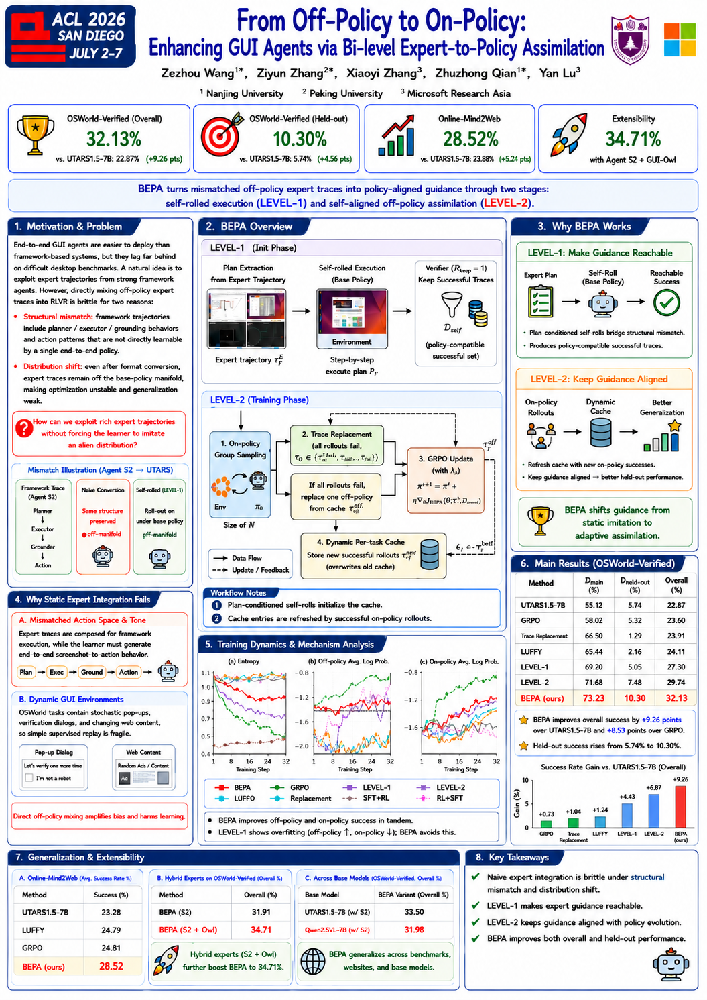
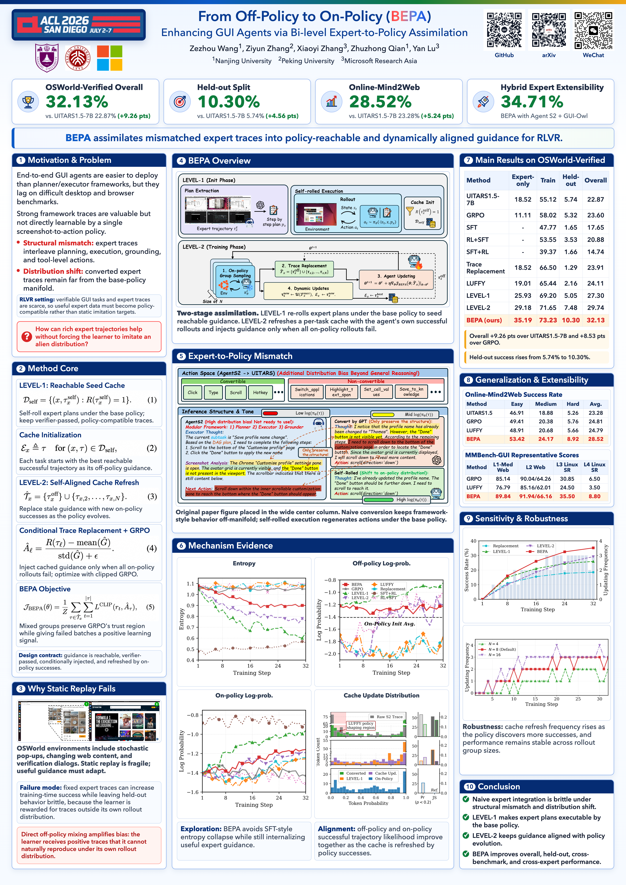
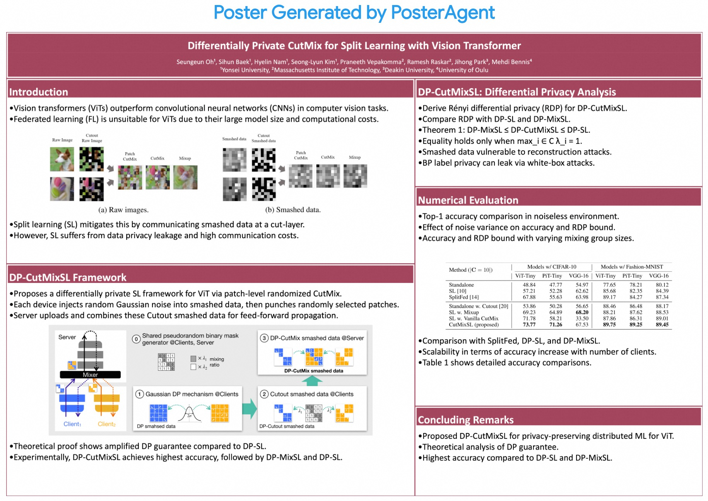

# Skill2Poster

[中文](README.md) | [English](README.en.md) | [Project page](https://leon-gittech.github.io/Skill2Poster/)

Skill2Poster is a Codex skill pack for academic poster generation. It helps turn research papers into accurate A0 HTML/PDF-style posters by using AI image generation only as a visual design reference, then rebuilding the final poster with verified paper content, figures, tables, equations, logos, QR codes, and measurements.

Skill2Poster 是一个 skill-driven 的学术海报生成工作流，用来把论文内容转成视觉质量较高、信息准确、可检查的 academic poster。项目包含两个 Codex skills、示例产物和一个可发布的 project page，核心流程是：

1. 先生成一张质量不错的 poster 设计参考图。
2. 再基于设计参考图，用真实论文内容和素材实现高清、准确、可渲染的 HTML poster。

这里的关键判断是：图像生成很适合探索版式、视觉层级、密度、配色和整体风格，但不应该作为最终事实来源。Skill2Poster 把生图结果当作设计参考，而不是当作最终 poster 本身；最终 poster 需要在 HTML 中重新构建，并替换为真实文本、图表、公式、logo、二维码和实验数字。

## 适合谁

- 想把 research paper、LaTeX project 或 PDF 快速转成 conference poster 的研究者。
- 需要一个可检查、可导出、尺寸准确的 HTML academic poster workflow 的用户。
- 想把 AI poster mockup 用作设计参考，但不想让生成图虚构文本、公式、表格和实验数字的用户。
- 想复用 Codex skills 来拆分 poster design、content audit、HTML rendering 和 layout QA 的用户。

## Motivation

学术海报难做，是因为它同时包含两类任务：

- 内容压缩：从论文里决定哪些问题动机、方法机制、实验结果和结论应该被保留下来。
- 视觉生产：把这些内容组织成 A0 poster 上可读、平衡、符合会议展示场景的视觉结构。

[Paper2Poster](https://github.com/Paper2Poster/Paper2Poster) 这类系统主要关注从 paper PDF 到 editable poster artifact 的自动化生成。Skill2Poster 采取一个互补但更偏实现落地的路径：把 poster 生成拆成可复用的 skills，先利用 image generation 快速得到设计参考，再用真实内容重建为可检查、可导出的 HTML poster。

这样拆分的原因是，当前图像模型可以生成很有视觉吸引力的 poster mockup，但容易扭曲文本、公式、表格、二维码和具体数值。Skill2Poster 明确把生成图限制在设计参考层，最终事实仍然来自论文和本地素材。

## 项目内容

```text
.
├── README.md
├── README.en.md
├── SHARE.md
├── references/
│   └── from-off-policy-to-on-policy.bib
├── docs/
│   ├── index.html
│   ├── robots.txt
│   └── sitemap.xml
├── academic-poster-builder/
│   ├── SKILL.md
│   ├── agents/openai.yaml
│   └── references/poster-qa-checklist.md
├── paper-poster-imagegen/
│   ├── SKILL.md
│   ├── agents/openai.yaml
│   └── references/prompt-template.md
├── assets/
│   ├── poster_image.png
│   └── poster_html.png
└── P2P.jpg
```

### `paper-poster-imagegen`

这个 skill 用于生成和迭代 academic poster 的 image-generation prompt。它帮助整理 poster brief、指定 section 顺序、设计 metric cards、预留真实图表位置，并在进入 HTML 实现前先把视觉密度和结构跑通。

### `academic-poster-builder`

这个 skill 用于把 poster 概念图转成事实准确的 A0 HTML/PDF/PPT-style artifact。它强调 source audit、真实论文素材、A0 尺寸、可读字体、panel 对齐、overflow 检查和最终渲染 QA。

## 快速使用

1. 将 `paper-poster-imagegen/` 和 `academic-poster-builder/` 作为 Codex skills 使用。
2. 用 `paper-poster-imagegen` 整理 poster brief，并生成 A0 portrait 设计参考图。
3. 用 `academic-poster-builder` 基于真实论文内容和素材重建 HTML poster。
4. 渲染最终 HTML/PDF/PNG，并检查尺寸、overflow、裁切、可读性和事实一致性。

推荐的 GitHub topics：

```text
academic-poster, poster-generation, paper-to-poster, codex-skills,
ai-poster, research-poster, html-poster, image-generation,
scientific-visualization, conference-poster
```

## 示例论文引用

仓库中的示例 poster 图使用以下论文作为展示对象：

- Paper: *From Off-Policy to On-Policy: Enhancing GUI Agents via Bi-level Expert-to-Policy Assimilation*
- arXiv: <https://arxiv.org/abs/2601.05787>
- BibTeX: [references/from-off-policy-to-on-policy.bib](references/from-off-policy-to-on-policy.bib)

## 需要准备的输入

Skill2Poster 最适合在这些输入齐备时使用：

- 论文来源：PDF、LaTeX project、abstract、method、results、conclusion 和 appendix 中的 figure/table 引用。
- 视觉素材：论文原始 figures、tables、equations、logos、QR codes、screenshots，以及已有 poster draft。
- 结果事实：核心指标、baseline 对比、section claims、limitations 和 captions。
- 会议信息：A0 portrait 目标、conference mark、机构 branding、作者列表、footer 或 QR 规范。
- 可选参考：已有 poster 图、视觉 mood board、HTML/PPT/PDF poster 输出。

如果某些精确数值暂时缺失，生图阶段应该使用清晰 placeholder；进入 HTML 实现时再替换成验证过的真实内容。

## Pipeline

### 1. 审计论文和素材

先从论文和本地 assets 出发，确认中心论点、必要 figures、核心 equations、主要结果表格和会议信息。这样可以避免 poster 变成只有视觉效果、但细节虚构的装饰性摘要。

### 2. 构建 poster brief

准备一个紧凑的 brief：

- title、subtitle、authors、affiliations 和 logos；
- 四个顶部 metric cards；
- 一句 thesis sentence；
- section 顺序和每个 section 的目的；
- 必须出现的 figures 及其推荐位置；
- QR codes 和链接；
- 来自旧 draft 或用户反馈的 negative constraints。

### 3. 生成设计参考图

使用 `paper-poster-imagegen` 生成高保真的 A0 portrait mockup。目标不是得到最终事实 artifact，而是得到一个视觉结构可信的参考图：三栏主体、清晰 header、metric strip、thesis strip，以及真实图表的占位区域。

设计参考图示例：



### 4. 评审和迭代参考图

如果 mockup 出现小到不可读的文字、虚构图表、重复表格、裁坏的 figure、随机 section、装饰性 footer 或大块意外空白，就继续修改 prompt。只有当参考图能指导实现时，才进入 HTML 阶段。

### 5. 重建高清 HTML poster

使用 `academic-poster-builder` 把 poster 实现为 A0 HTML canvas：

- 物理目标：`841mm x 1189mm`；
- CSS canvas：96 dpi 下 `3179px x 4494px`；
- 150 dpi PNG 导出：约 `4967px x 7022px`；
- 使用真实论文文本、figures、tables、logos、QR codes 和 equations；
- 不信任生图里的文字、数字和公式。

HTML 导出示例：



### 6. 渲染和验证

交付前做 layout QA：

- 确认页面尺寸；
- 检查 panel overflow；
- 验证字体可读性；
- 确认 figures 和 tables 没有被裁切；
- 对齐各列底部；
- 人工检查最终 PNG/PDF。

## 与 Paper2Poster 的对比

Paper2Poster 是一个 paper-to-poster 自动化项目，把 poster generation 视为从论文内容到 editable poster artifact 的 multi-agent pipeline。它的 GitHub 仓库是 [Paper2Poster/Paper2Poster](https://github.com/Paper2Poster/Paper2Poster)。

Skill2Poster 的目标更窄，也更偏实现流程：

| 维度 | Paper2Poster | Skill2Poster |
| --- | --- | --- |
| 主要目标 | 端到端 paper-to-poster 自动化 | 可复用的高质量 poster 构建 skills |
| 设计策略 | 从 paper inputs 出发的 agentic poster generation | 先生成设计参考图，再准确重建 HTML |
| 事实来源 | Paper 和 agent 生成的 poster artifact | Paper、本地素材、验证过的 metrics 和 rendered HTML |
| 图像生成角色 | poster generation workflow 的一部分 | 只做设计探索，不做事实权威 |
| 最终实现重点 | Editable poster output | 高清、可测量、A0 尺寸的 HTML/PDF-style output |

Paper2Poster-style 示例：



## 预期输出

最终产物不应该只是一张看起来不错的 poster 截图，而应该满足：

- 视觉质量接近 top-conference poster 标准；
- 内容事实来自论文和本地素材；
- 渲染尺寸兼容 A0；
- HTML 可检查；
- 可导出高清 PNG/PDF；
- 已检查 overflow、裁切和可读性。

Skill2Poster 因此更像是连接“快速视觉构思”和“可靠 poster 实现”的桥梁。
